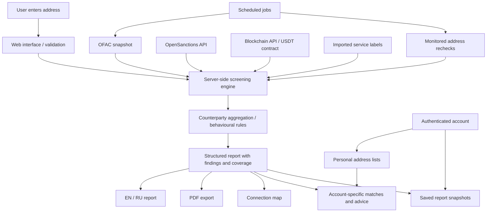

# Architecture

This is a conceptual view of the current application. It omits source code, infrastructure identifiers, credentials, raw datasets and private account records.

## Screening flow

1. Validate and normalise the submitted address.
2. Retrieve sanctions matches, blockchain facts and relevant labels server-side.
3. Aggregate counterparties within the returned transaction window.
4. Apply deterministic rules and record the source status and coverage.
5. Render one structured result as web content, PDF and a connection map.
6. For signed-in users, check private labels separately and optionally save a snapshot.

## Data boundaries

| Boundary | Design |
|---|---|
| Public screening | Uses public address data and configured sources; does not establish ownership |
| Personal lists | Account-scoped labels, reasons and sources; separate from public scoring |
| Saved results | Snapshot at save time; distinct from a fresh check |
| Credentials | Server environment; excluded from this repository |
| Third-party data | Not bundled in the public showcase |

## Failure and coverage

Source failures are recorded. Confirmed findings remain available when another source fails. Scope is stated through the analysis window and the number of counterparties checked; a completed scoped check does not imply exhaustive screening.

Short-lived caching reduces repeated upstream requests. Results are time-specific and should not be treated as continuous assurance.

## Presentation

The engine produces structured finding codes and parameters. EN/RU presentation uses dictionaries. A checksum supports comparison of report content; it is not a regulator certification or proof of lawful funds.

## Deliberately private

Implementation files, deployment configuration, database migrations, internal endpoints, proprietary label collections and personal account data remain outside this showcase.
