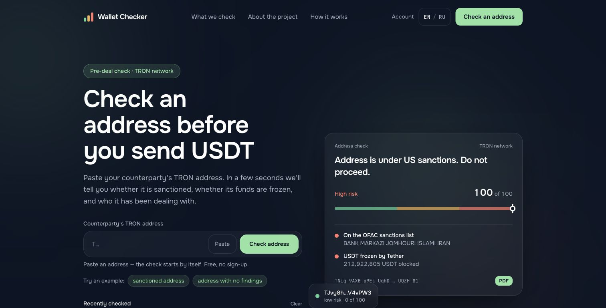
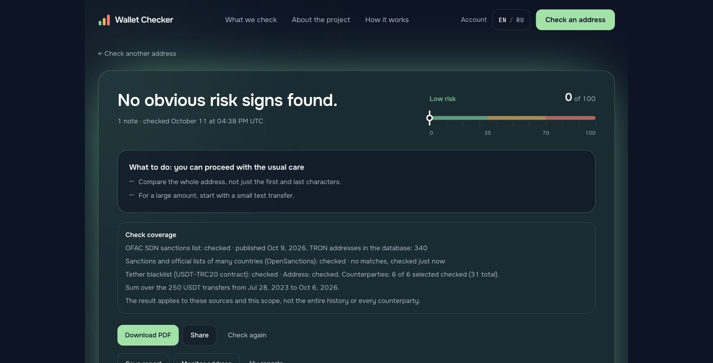
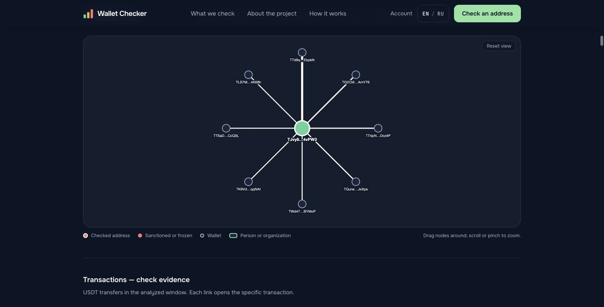
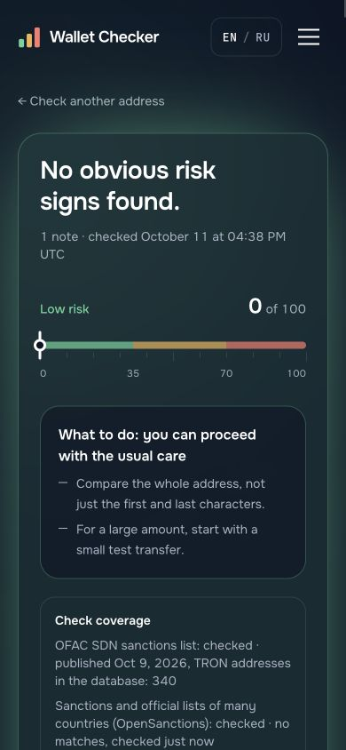

# Wallet Checker

**Explainable wallet screening, designed by an AML practitioner.**

Wallet Checker brings sanctions screening, on-chain signals and readable evidence into one address report. It is a personal project exploring how a complex compliance workflow can be made easier to understand.

[Open the live demo](https://app-one-alpha-10.vercel.app/en) · [Architecture](ARCHITECTURE.md) · [Screenshots](SCREENSHOTS.md)

This repository contains project documentation and screenshots. The application source code is publicly available: [Niphridium/wallet-checker](https://github.com/Niphridium/wallet-checker). Imported service datasets and personal account data are excluded.

## The problem

Before a crypto transfer, an analyst needs to understand what was checked, which signals were found and what remains unknown. A score alone does not answer those questions.

## What the demo demonstrates

- Public sanctions screening using OFAC SDN and OpenSanctions.
- TRON USDT freeze checks against the token contract.
- Transfer aggregation, counterparty analysis and explainable behavioural rules.
- Explicit source status, transaction window and counterparty coverage.
- A bilingual web report, PDF export and an interactive connection map.
- Optional accounts with saved report snapshots, personal address lists and monitoring.

The public walkthrough focuses on TRON / USDT-TRC20. It does not promise full-chain or full-history coverage.

## My contribution

I defined the screening workflow, risk rules, source requirements and report structure; made architecture decisions; and validated the output against public examples. I used AI coding tools to help implement and iterate on the application.

The project connects my AML/KYC/KYT experience with hands-on product development.

## Product walkthrough

### Address input

### Report and coverage

### Connection map

### Mobile report

These are screenshots of the live demo, captured on 11 October 2026. Results and source versions can change.

## Design choices

**Explain the result.** Findings have readable reasons and source context instead of only a numeric score.

**Separate public checks and private labels.** Personal lists are account-specific and do not change the public risk score. A personal blacklist match changes the advice shown to that account.

**Expose coverage.** A successful check means the configured checks completed within the stated scope. It does not mean every counterparty or all historical transactions were screened.

**Preserve evidence.** Saved reports capture the result at the time of saving. A later recheck produces a new result.

## Scope and interpretation

The score is a rule-based screening aid, not a probability of crime or an official compliance opinion. Absence of a finding is not evidence of lawful fund origin. Entity attribution is shown from source records rather than established independently by the application. Imported service labels are distinct from official sanctions.

## Technology

Next.js · React · TypeScript · Tailwind CSS · Node.js · Supabase · Vercel · Cytoscape.js · PDF rendering.

## Data and commercial status

The current demo has no payment flow. Future commercial availability, pricing and coverage are undecided.

OpenSanctions is used under the applicable non-commercial terms in the current demo. A paid service would require suitable commercial rights for its data sources and API use. No third-party datasets are distributed in this repository.

Sources: [OFAC](https://ofac.treasury.gov/) · [OpenSanctions licensing](https://www.opensanctions.org/docs/commercial/exemption/) · [TronGrid](https://www.trongrid.io/).

Documentation and screenshots are shared for portfolio review. Public source code is available for review; no open-source license is granted.
